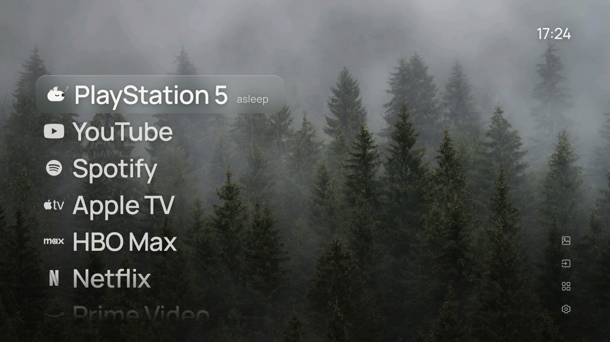
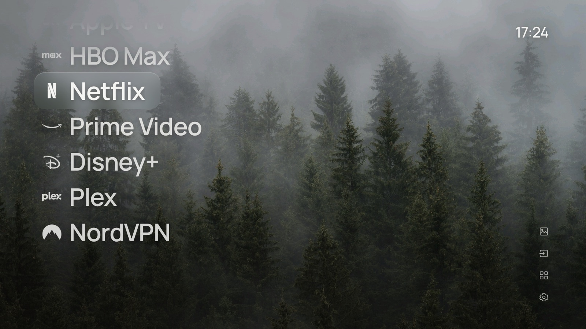
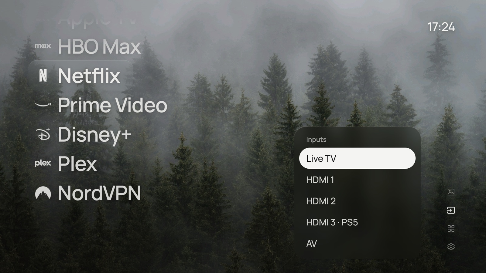

# cleanyourtv-firetv

**A quiet home screen and a thorough debloat for Fire TV Edition TVs.** Your apps as a list of names over a
photograph, one glass focus plate, the time and four small controls. No ads, no sponsored rows, no Luna tiles.
Underneath: Amazon's and the TV maker's telemetry, ad and content-recognition apps switched off or removed,
reversibly.

<p align="center"></p>

<table><tr>
<td></td>
<td></td>
</tr></table>

Built and tested on a **Xiaomi L65MB-FAEU** (Xiaomi F2 65", Amazon `AFTBR92D74` / `ginzaeu`, MediaTek MT5873,
Fire OS 8.1.8.5 = Android 11). Other Fire TV Edition TVs and sticks on Fire OS 8 should work with small changes
(the HDMI input IDs, and which packages exist). Treat the debloat list as a starting point and read it first.

## What you get

- **The home screen** (`launcher/`, package `tv.clean.home`), after [CleanFrame](https://github.com/nthnclrk/CleanFrame)'s
  List layout: large names with monochrome service marks, a frosted plate that stays still while the list glides
  under it, the clock top right, and four controls bottom right: **Wallpaper**, **Inputs** (Live TV, HDMI, AV),
  **Fire TV UI** (the Appstore or Amazon's original home, when you need them) and **Settings**.
- **A console tile:** a little capybara that sleeps while the console on HDMI is in standby and runs when it is
  on (read from the TV input framework, no polling). OK switches to that input. While an HDMI input shows a
  picture, the TV's screensaver and auto-sleep stay off, and come back when the signal goes.
- **Wallpapers:** 15 Unsplash photos bundled (via CleanFrame), plus your own (`set-wallpaper.sh`,
  `set-photos.sh`). The home shuffles to another photo every 3 minutes.
- **A screensaver** that cross-fades through the same photos with a clock, instead of Amazon's, which carries
  sponsored content.
- **The Home button** brings you back here, also after a reboot. The launcher keeps its Home watch on and bound by
  itself, and stands aside if it ever crash-loops so the TV stays usable.
- **Light on a 1 to 2 GB TV:** no internet permission, no live blur (the glass uses a small blurred copy of the
  photo made once), no video, about 0% CPU when idle.
- **The debloat** (`debloat.txt`, `remove.sh`): 45 entries in five batches, each with the reason. ACR (the
  service that fingerprints what is on screen, HDMI included), the advertising ID and ad tokens, ad bidding,
  sponsored previews, Fire TV Channels / "Amazon Luna", promo cards, Amazon and Xiaomi telemetry, the Wi-Fi
  password uploader, Content Personalization, Amazon's screensaver, shopping, tutorials and preloads.
- **Ad-blocking DNS** (optional): Private DNS set to AdGuard. It doesn't block YouTube ads.

### What Fire OS doesn't allow, and how this works around it

| Fire OS 8 limit | Here |
|---|---|
| `com.amazon.tv.launcher` is protected: it can't be disabled or replaced as Home | An accessibility service sees Amazon's home come to the front and puts this one over it (about 0.2 s, so you may see a flash) |
| The Home key never reaches accessibility key filters; the "homekey" broadcast needs an Amazon signature | The window event is the signal. One gap: pressing Home *while on* Amazon's home (opened from Fire TV UI) does nothing; open any app or pick "Home" in its Your Apps row |
| Amazon's input switcher (`tvinput://tunenow`) needs an Amazon signature | HDMI and AV play in the launcher's own full-screen `TvView` |
| Appstore updates switch disabled packages back on | `remove.sh` uninstalls them for the user (`pm uninstall -k --user 0`); factory-version packages refuse (`DELETE_FAILED_INTERNAL_ERROR`) and are disabled instead; the launcher hides the usual comeback apps |
| Some telemetry packages are protected | AdGuard DNS blocks the metrics server they report to |
| ADB debugging switches itself off at every reboot on this TV | Turn it back on when you want to run the scripts |

## Set it up

You need a Mac or Linux computer on the same network, Python 3.8+, and for the launcher a JDK 17+ and the
Android SDK command-line tools.

1. **On the TV:** Settings > My Fire TV > About: press OK on the first entry 7 times to unlock Developer options.
   Then Developer options > **ADB debugging: On**. Note the TV's IP (Settings > Network).
2. **On the computer:**
   ```sh
   git clone https://github.com/adam-nadeem7/cleanyourtv-firetv && cd cleanyourtv-firetv
   python3 -m venv .venv && .venv/bin/pip install -r requirements.txt
   export TV_IP=192.168.1.50                     # your TV
   .venv/bin/python tv.py sh "getprop ro.product.model"
   ```
   The TV asks **"Allow USB debugging?"**: tick "Always allow from this computer" and press OK.
3. **Back up first** (keep it private: it contains serial numbers and account names):
   ```sh
   mkdir -p backup && for t in global secure system; do .venv/bin/python tv.py sh "settings list $t" > backup/settings-$t.txt; done
   .venv/bin/python tv.py sh "pm list packages -f" > backup/packages.txt; .venv/bin/python tv.py sh getprop > backup/getprop.txt
   ```
4. **Debloat.** Read `debloat.txt` and comment out (`#`) anything you use. Batch 4 holds the original owner's
   unused apps and casting choices: edit it for yours. Then, one batch at a time, checking the TV in between:
   ```sh
   ./remove.sh 1      # telemetry
   ./remove.sh 2      # ads, ACR, sponsored content
   ./remove.sh 3      # tutorials and preloads
   ./remove.sh 4      # your unused apps and casting
   ./remove.sh 5      # the re-check: ad tokens, Wi-Fi uploader, personalisation, screensaver
   ./remove.sh        # all of them, plus Prime Video's background running off
   ```
   Optional ad-blocking DNS:
   `.venv/bin/python tv.py sh "settings put global private_dns_specifier dns.adguard-dns.com; settings put global private_dns_mode hostname"`
5. **The home screen.** Check `launcher/app/src/main/res/values/config.xml` first: `app_order`, and `ps5_input`
   (your console's HDMI input; list them with `.venv/bin/python tv.py sh "dumpsys tv_input" | grep HdmiInputService`,
   and `dumpsys hdmi_control` shows which port the console reports over CEC). Then:
   ```sh
   brew install --cask android-commandlinetools     # once; or set sdk.dir in launcher/local.properties
   ./build-and-install.sh
   ```
   It builds the APK, installs it with `pm install` (plain `adb install` can hang), grants its permissions,
   switches on the Home watch and the screensaver, and pushes your wallpapers if you have any.

## Make it yours

```sh
./set-order.sh com.netflix.ninja com.amazon.firetv.youtube   # these first, the rest A to Z (--list, --reset)
./set-wallpaper.sh ~/Pictures/photo.jpg                       # "Your photo" in the gallery
./set-photos.sh --add ~/Pictures/lisbon.jpg "Lisbon"          # more of your own; or edit photos/names.txt
```

Service marks for more apps go in `Marks.java` (monochrome 24 px vectors; `mark_*.xml` were converted from
Simple Icons SVGs). Apps without a mark get a monogram.

## Undo

```sh
./restore.sh com.amazon.cloud9     # one package back (reinstalls the system copy, or re-enables it)
./restore.sh                       # everything, Prime background running, and DNS back to automatic
.venv/bin/python tv.py sh "pm uninstall tv.clean.home"        # remove the home screen; Amazon's is back at once
```

Amazon's screensaver after `restore.sh`:
`.venv/bin/python tv.py sh "settings put secure screensaver_components com.amazon.ftv.screensaver/.app.services.ScreensaverService"`.
Third-party apps removed in batch 4 come back from the Appstore. When you're done, switch ADB debugging off again.

**Use at your own risk.** Everything here is reversible and was lived with on one TV, but Fire OS differs between
models and updates. Disable in small batches and check the TV between them.

## Credits

- Design, the wallpaper set and the Manrope type from [CleanFrame](https://github.com/nthnclrk/CleanFrame) by
  Nathan Clark (MIT, `launcher/CLEANFRAME-LICENSE.txt`). Photos: Unsplash License, photographers listed in
  `launcher/app/src/main/assets/wallpapers/catalog.txt`.
- The self-healing Home watch, boot catch and crash guard follow [couch-tv](https://github.com/Seagey/couch-tv)'s
  FireWatch (MIT); its privacy list added the ad-token service.
- The debloat approach and example lists from [cleanyourtv](https://github.com/Gathin23/cleanyourtv).
- Service marks: [Simple Icons](https://simpleicons.org) (CC0) and Custom Brand Icons (MIT, Disney+). The marks
  are trademarks of their owners; this project isn't affiliated with or endorsed by any of them, Amazon or Xiaomi.
- Manrope: SIL Open Font License (`launcher/MANROPE-OFL.txt`).

Licence: MIT (`LICENSE`).
